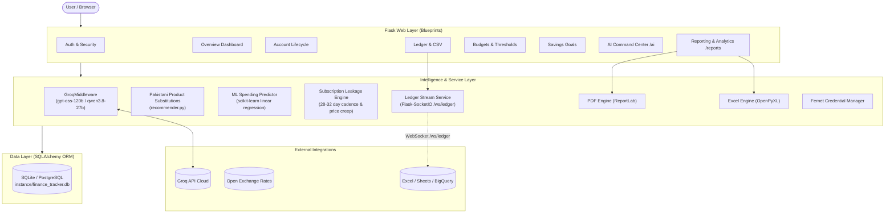
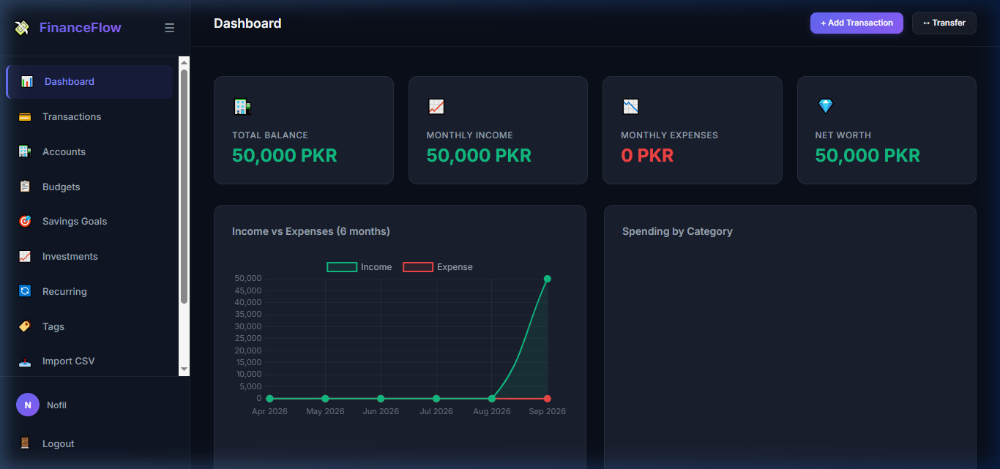
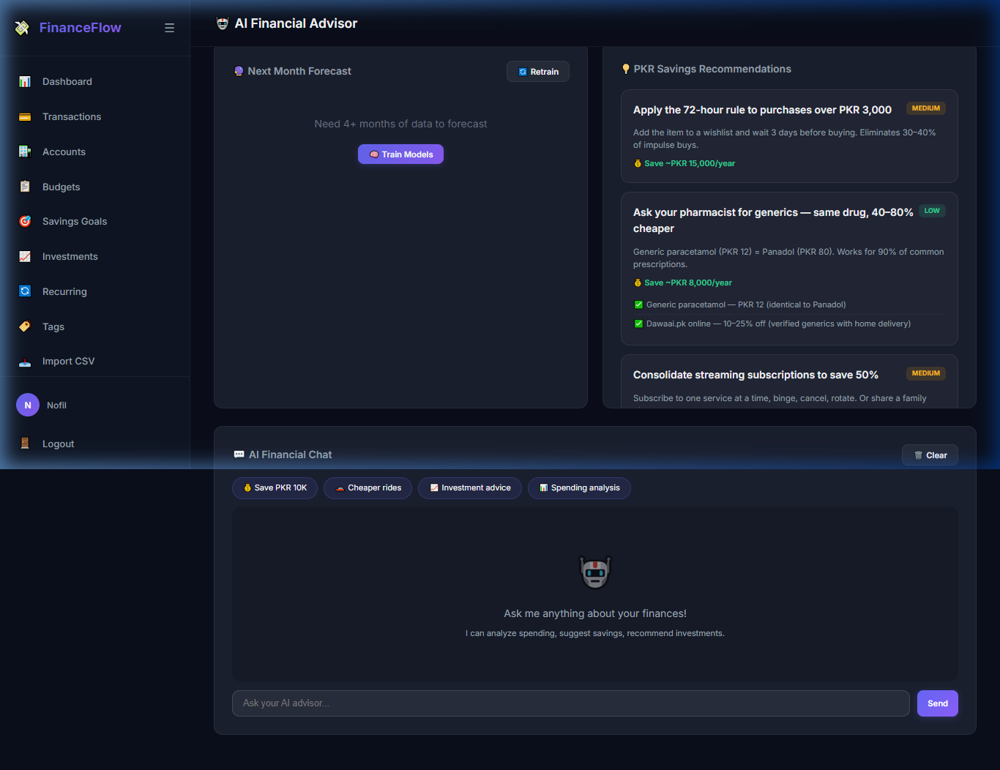
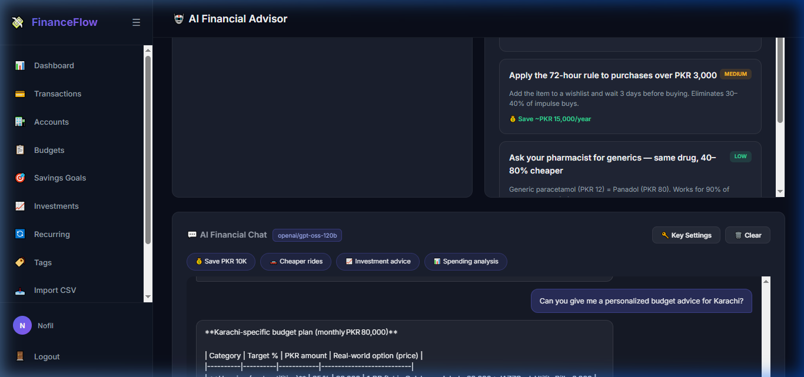
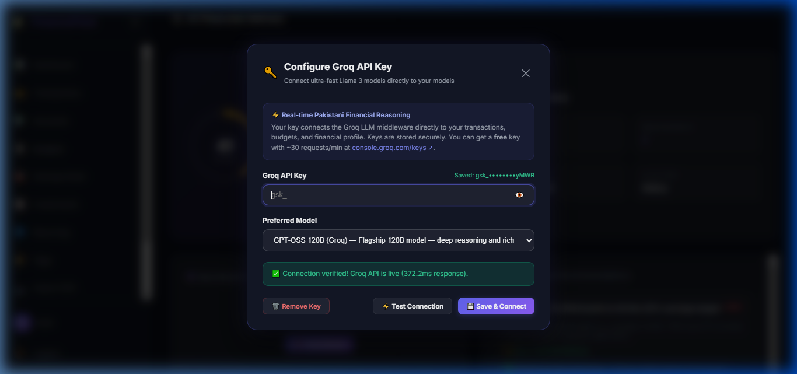
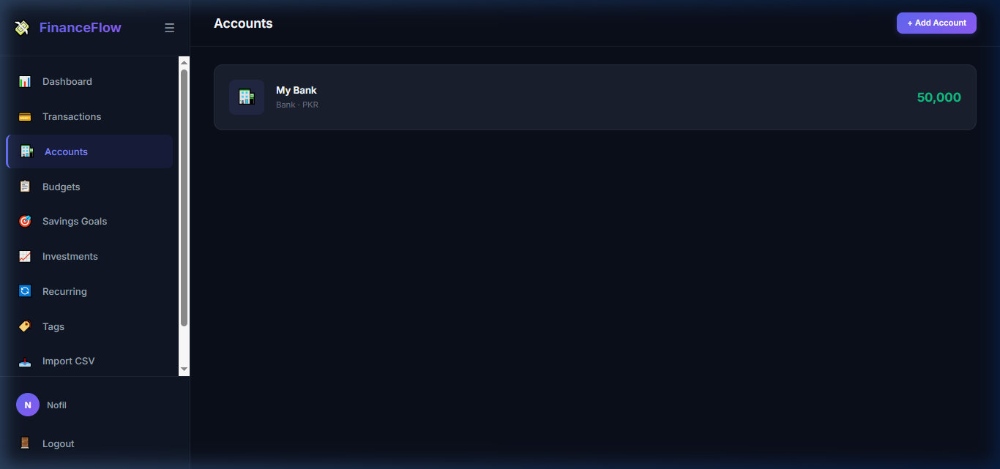
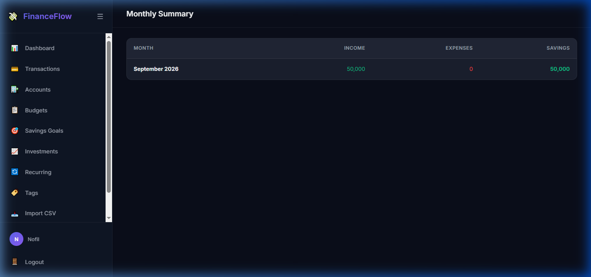

# FinanceFlow — AI-Powered Personal Finance Advisor & BI Analytics

> An intelligent, localized personal finance management ecosystem localized for the Pakistani economy. Combines a full double-entry ledger with an ultra-fast LLM financial advisor powered by Groq, predictive spending regressions, real-time WebSocket ledger sync, and dual-format report generation.

[](https://opensource.org/licenses/MIT)
[](https://www.python.org/)
[](https://flask.palletsprojects.com/)
[]()

---

## 🏗 Architecture & System Skeleton



---

## 🚀 Key Features

1. **Complete Ledger & Wealth Tracking**: Multi-account support (Checking, Savings, Cash, Wallets like JazzCash/Easypaisa), categorized income/expense transactions, and visual budget goals.
2. **AI Financial Advisor with Groq**: High-speed conversational AI reasoning using `openai/gpt-oss-120b` and `qwen/qwen3.8-27b` with encrypted per-user API key management.
3. **Pakistani Market Context & Health Scoring**: Financial health scoring (0–100), automated category spending flags, and localized product substitutions (e.g., InDrive for Careem, generic medicines, domestic retail options).
4. **Predictive Spending Analytics**: Scikit-learn regression models projecting end-of-month expenditure against actual income.
5. **Real-Time WebSocket Ledger Sync**: `/ws/ledger` broadcasting live transaction updates to connected web clients, Google Sheets, Excel Add-ins, and BigQuery data pipelines.
6. **Executive Dual-Format Reporting**: Export comprehensive monthly statements in high-res ReportLab PDF or Power Query-ready OpenPyXL spreadsheets.
7. **Subscription Leakage Scanner**: Automated heuristic detection of 28–32 day billing cycles identifying zombie subscriptions and silent price creep (>5%).

---

## 📸 Application Walkthrough & Visual Tour

Experience FinanceFlow's localized interface, intelligent advisor, and real-time reporting capabilities.

### 1. Executive Dashboard & Financial Health Overview
Live net-worth tracking, multi-account liquid balances, cash flow metrics, and localized spending predictions.



---

### 2. AI Financial Advisor & Pakistani Localization
Kaggle-calibrated financial health scoring (0-100), localized inflation guidance, emergency fund recommendations, and Pakistani product substitution engine.



---

### 3. High-Speed LLM Advisory via Groq (Llama 3.3 70B & Qwen 3.8 27B)
Direct multi-turn conversational advice tailored to the Pakistani macroeconomic context, offering actionable asset allocation and inflation hedging strategies.



---

### 4. Zero-Friction BYO-Key Modal & Fernet Encryption
Users can insert and verify their personal Groq API keys with live ping diagnostics. Credentials are encrypted at rest using AES-128-CBC/Fernet.



---

### 5. Multi-Account Portfolio Management
Track bank accounts (e.g., Meezan, HBL, Nayapay, Sadapay), physical cash wallets, credit lines, and real-time balances.



---

### 6. Analytics, Monthly Reports & Dual-Format Export
Comprehensive monthly income vs. expense breakdown, heuristic subscription leakage scanner, and single-click in-memory ReportLab PDF and OpenPyXL Excel statement exports.



---

## 📂 Repository Directory Structure

```
├── .agent/                    # GSD workflow scripts
├── .agents/                   # Agent skills (planner, executor, verifier)
├── .gsd/                      # GSD roadmap, architecture, milestones, memory
│   ├── ARCHITECTURE.md        # Detailed system component mapping
│   ├── STACK.md               # Technology inventory
│   ├── SPEC.md                # Project requirements & criteria
│   ├── TODO.md                # Backlog items
│   └── milestones/            # Archived milestone artifacts (v1.0)
├── finance_app/
│   ├── app/
│   │   ├── accounts/          # Account management blueprint
│   │   ├── ai/                # AI advisor & Groq key management
│   │   ├── auth/              # User authentication & session management
│   │   ├── budgets/           # Monthly limit tracking
│   │   ├── dashboard/         # Core metrics & financial overview
│   │   ├── models/            # SQLAlchemy database schemas
│   │   ├── reports/           # Financial heatmaps, PDF & Excel export routes
│   │   ├── services/          # Core business logic & intelligence engines
│   │   │   ├── groq_middleware.py
│   │   │   ├── ledger_stream.py
│   │   │   ├── pdf_export.py
│   │   │   ├── excel_export.py
│   │   │   ├── recommender.py
│   │   │   ├── spending_predictor.py
│   │   │   └── subscription_leakage.py
│   │   ├── static/            # CSS, JavaScript & client assets
│   │   ├── templates/         # Jinja2 HTML templates
│   │   └── transactions/      # Transaction recording & CSV imports
│   ├── tests/                 # Automated test discovery suite (43 tests)
│   ├── run.py                 # Application bootstrap runner
│   └── requirements.txt       # Production & development dependencies
├── LICENSE                    # MIT License
└── README.md                  # Project documentation & architectural guide
```

---

## 🛠 Quickstart Guide

### 1. Prerequisites
- Python 3.13+
- Git

### 2. Installation & Virtual Environment Setup
```powershell
# Clone repository
git clone https://github.com/Mujtaba-Zahid/Project.git
cd Project/finance_app

# Create virtual environment
python -m venv venv
venv\Scripts\activate   # On Windows
# source venv/bin/activate  # On Linux/macOS

# Install dependencies
pip install -r requirements.txt
```

### 3. Environment Configuration
Create a `.env` file in `finance_app/`:
```env
SECRET_KEY=your-secret-key-here
DATABASE_URL=sqlite:///instance/finance_tracker.db
GROQ_API_KEY=optional_fallback_groq_api_key
OXR_APP_ID=optional_open_exchange_rates_key
ENCRYPTION_KEY=32_urlsafe_base64_encryption_key
```

### 4. Running the Application
```powershell
python run.py
```
Open [http://127.0.0.1:5000](http://127.0.0.1:5000) in your browser.

---

## 🧪 Running the Test Suite

```powershell
cd finance_app
$env:PYTHONPATH="."
venv\Scripts\python.exe -m unittest discover -s tests -p "test_*.py"
```
*Current test status: 43/43 tests passing.*

---

## 📜 License
Distributed under the [MIT License](LICENSE). Copyright (c) 2026 Mujtaba Zahid.

